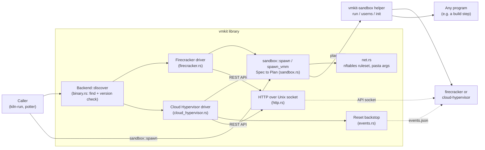
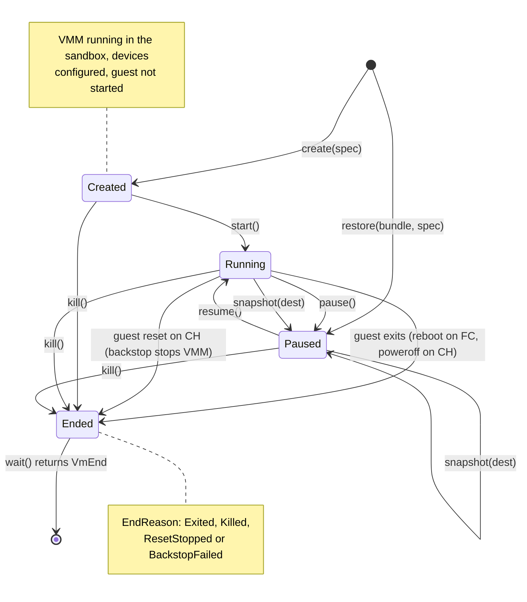
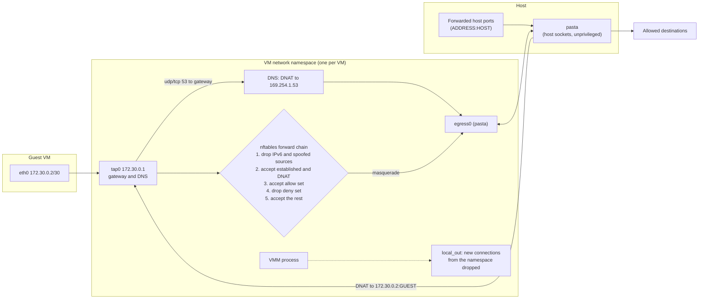
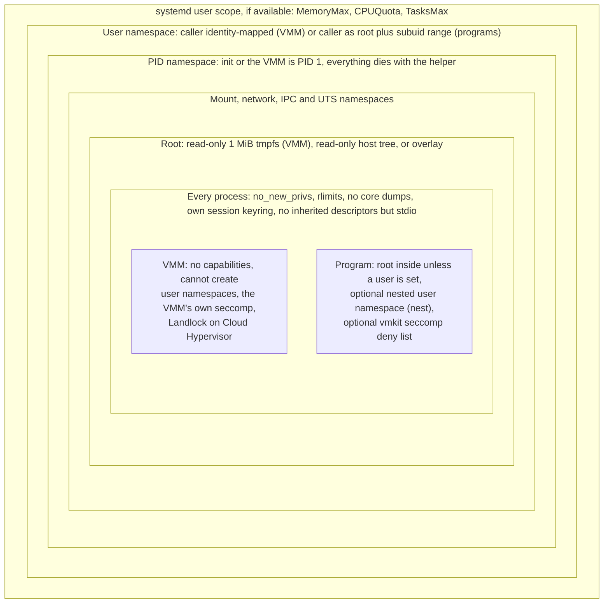

# vmkit

vmkit is a Rust library that runs microVMs on [Firecracker](https://github.com/firecracker-microvm/firecracker) and [Cloud Hypervisor](https://github.com/cloud-hypervisor/cloud-hypervisor) behind one backend-neutral API, plus the guest kernel they boot. Every VMM runs unprivileged, inside a rootless sandbox (`vmkit-sandbox`) with its own namespaces, an empty read-only root and, when the guest has a network, an nftables egress policy with `pasta` for outbound traffic. The same sandbox can run any other program, for example a build step. vmkit is the VM layer of [kiln](https://github.com/AlfonsoCampodonico/kiln) and the build sandbox of [potter](https://github.com/AlfonsoCampodonico/potter).

## Contents

- [Status](#status)
- [Quick start](#quick-start)
- [Concepts](#concepts)
- [Architecture](#architecture)
- [API reference](#api-reference)
- [Sandboxing any program](#sandboxing-any-program)
- [How it relates to potter and kiln](#how-it-relates-to-potter-and-kiln)
- [Requirements](#requirements)
- [Kernel](#kernel)
- [Tests](#tests)
- [Repository layout](#repository-layout)
- [Documentation](#documentation)

## Status

Version 0.1.0. Not published to crates.io; consumers depend on it by git revision.

| Area | State | Notes |
|---|---|---|
| Firecracker backend: create, start, pause, resume, kill, wait | Works | Firecracker 1.17.0 or later. Contract, network and pause suites on x86_64 (CI) and aarch64 (Lima). |
| Cloud Hypervisor backend: same operations | Works | Cloud Hypervisor 53.0 or later. On aarch64 under nested virtualization, a guest can stay stuck after `resume` while other VMs load the host; see [Tests](#tests). |
| Disks, vsock, one NIC per VM | Works | Raw disk images only. vsock uses each VMM's Unix-socket scheme; guest-initiated connections are tested. |
| Guest networking (tap, nftables policy, `pasta` egress, port forwards) | Works | IPv4 only; IPv6 from the guest is dropped. |
| VMM sandbox (`vmkit-sandbox`) | Works | Linux only. Refuses to run as root. |
| General program sandbox (`vmkit::sandbox::spawn`) | Works | Linux 5.12 or later; subordinate ids need `newuidmap`/`newgidmap`. |
| cgroup limits | Works when available | Only with a systemd user session that can create scopes (`vmkit::cgroups_available()`). Otherwise skipped. |
| Snapshot and restore | Works | Full snapshots of state, memory and writable disks into a bundle directory; restore into a fresh sandboxed VMM. Same VMM, version and arch only. Snapshot suite on aarch64 (Lima) and x86_64 (CI). |
| Lazy restore | Works (Linux) | A FUSE mount in the sandbox serves memory and disks from verified chunks fetched on demand (`vmkit::lazy`). Lazy memory on Firecracker always; on Cloud Hypervisor only with userfaultfd access, else memory is copied in through the same layer. |
| Balloon, drive remapping, diff snapshots | Not implemented | `Capabilities` reports what each backend could support; vmkit has no API for them yet. |
| macOS | Builds only | The library compiles and its unit tests pass; creating VMs or sandboxes needs Linux. |
| `base` kernel profile | Released | `kernels-6.18.54`: GitHub release assets and `ghcr.io/alfonsocampodonico/vmkit-kernels/base`. |

## Quick start

This boots the repository's busybox test guest once on each backend. It needs Linux with KVM (`/dev/kvm`, your user in the `kvm` group), `curl`, a C compiler and a static busybox (`busybox-static` on Debian and Ubuntu). On a Mac, run it in the [Lima template](#on-a-mac).

```bash
git clone https://github.com/AlfonsoCampodonico/vmkit && cd vmkit

# The pinned VMMs (SHA-256 checked) and the sandbox helper.
scripts/install-vmms.sh ~/.local/bin
export PATH="$HOME/.local/bin:$PATH"
cargo build --release --bin vmkit-sandbox
sudo install -m 0755 target/release/vmkit-sandbox /usr/local/bin/
scripts/install-apparmor.sh /usr/local/bin/vmkit-sandbox   # does nothing where AppArmor allows user namespaces

# A kernel (the released base profile) and the test guest.
mkdir -p out
curl -fL -o out/vmlinux https://github.com/AlfonsoCampodonico/vmkit/releases/download/kernels-6.18.54/vmlinux-6.18.54-$(uname -m)
testguest/build-initramfs.sh out/initramfs.cpio.gz
```

Then build this program as a binary named `quickstart`, in a crate that depends on vmkit (`vmkit = { git = "https://github.com/AlfonsoCampodonico/vmkit" }`):

```rust
use std::path::PathBuf;

use vmkit::{Backend, GuestExit, VmSpec};

fn main() -> Result<(), Box<dyn std::error::Error>> {
    // quickstart <vmlinux> <initramfs.cpio.gz> <run dir>
    let args: Vec<PathBuf> = std::env::args_os().skip(1).map(PathBuf::from).collect();
    let (kernel, initramfs, run_dir) = (&args[0], &args[1], &args[2]);

    for backend in Backend::ALL {
        let vmm = backend.discover()?; // $VMKIT_FIRECRACKER / $VMKIT_CLOUD_HYPERVISOR, else PATH
        // How the guest must end itself so that the VMM exits.
        let exit = match vmm.capabilities().guest_exit {
            GuestExit::Reboot => "vmkit.exit=reboot",
            GuestExit::Poweroff => "vmkit.exit=poweroff",
        };
        let dir = run_dir.join(vmm.name());
        std::fs::create_dir_all(&dir)?;
        let mut vm = vmm.create(&VmSpec {
            kernel: kernel.clone(),
            initramfs: Some(initramfs.clone()),
            cmdline: ["panic=-1", "rdinit=/init", "vmkit.test=up", exit].map(String::from).to_vec(),
            disks: vec![],
            vcpus: 1,
            memory_mib: 256,
            vsock: None,
            net: None,
            console_log: dir.join("console.log"),
            run_dir: dir.clone(),
        })?;
        vm.start()?;
        let end = vm.wait()?;
        println!("{}: {:?}", vmm.name(), end);
    }
    Ok(())
}
```

```console
$ quickstart "$PWD/out/vmlinux" "$PWD/out/initramfs.cpio.gz" "$PWD/run"
firecracker: VmEnd { reason: Exited, code: Some(0), signal: None }
cloud-hypervisor: VmEnd { reason: Exited, code: Some(0), signal: None }
$ grep VMKIT-GUEST-UP run/*/console.log
run/cloud-hypervisor/console.log:VMKIT-GUEST-UP action=up
run/firecracker/console.log:VMKIT-GUEST-UP action=up
```

`vmkit.test` and `vmkit.exit` are arguments of the test guest's `/init` (`testguest/init`), not of vmkit. A real guest decides how to end itself from `capabilities().guest_exit` the same way.

## Concepts

- **Backend and capabilities.** `Backend::Firecracker` and `Backend::CloudHypervisor` each find and version-check their binary (`Backend::discover`). Callers decide from `Vmm::capabilities()` (device budget, how the guest must exit, console device), never from the backend's name.
- **VmSpec.** Kernel, optional initramfs, kernel arguments, disks (attached in order as `vda`, `vdb`, ...), vCPUs, memory, optional vsock, optional network, a console log and a run directory. `VmSpec::check` refuses a spec before anything starts: too many devices, no vCPU or less than 64 MiB, kernel arguments that are not single words, non-UTF-8 paths, a missing run directory, or invalid port forwards.
- **Kernel arguments.** The guest's command line is the caller's `cmdline` plus what the driver appends: `console=<capabilities().console>`, and on x86_64 Firecracker `reboot=k i8042.noaux i8042.nomux i8042.dumbkbd`. Nothing else contributes.
- **Guest exit.** The guest ends the VM with `capabilities().guest_exit`: `reboot` on Firecracker, `poweroff` on Cloud Hypervisor. A Cloud Hypervisor guest reset is stopped, not rebooted: a backstop thread watches the VMM's event stream and kills it on a reset (`EndReason::ResetStopped`), so a workload never runs twice. If the backstop cannot read the stream it kills the VMM (`EndReason::BackstopFailed`) and writes why to `<run_dir>/backstop.log`.
- **Console.** Guest serial output is appended to `console_log`, which is opened by the caller's process before the VMM starts, so it can be a FIFO.
- **vsock.** Guest-initiated connections to host port `P` arrive on the Unix socket `<vm.vsock_socket()>_P` on both backends.
- **Run directory.** `run_dir` must exist and should be private (0700). It holds the sandbox plan, the VMM's logs and the PID file; the VMM itself only sees `<run_dir>/sock`, mounted at `/vm/sock`.
- **Sandbox.** Every VMM runs through the `vmkit-sandbox` helper as the invoking user, in its own user, PID, mount, network, IPC and UTS namespaces. See [Isolation layers](#isolation-layers).
- **Network.** `VmSpec::net` gives the guest `eth0` at `172.30.0.2/30`, gateway and DNS `172.30.0.1`, in the VM's own network namespace. Egress is policed by nftables and leaves through `pasta`. See [Network model](#network-model).

## Architecture

### Components

How a caller's request reaches a VMM process: the drivers configure the VMM over its REST API, and every process is started through the sandbox helper.



### VM lifecycle

The states a `Vm` goes through on both backends.



What each step does on each backend:

| Step | Firecracker | Cloud Hypervisor |
|---|---|---|
| `create` | starts `firecracker --api-sock /vm/sock/firecracker.sock --id vmkit --log-path /vm/sock/firecracker.log` in the sandbox, waits for the API socket (10 s), then `PUT /machine-config`, `/boot-source`, `/drives/disk<n>`, `/vsock`, `/network-interfaces/eth0` | starts `cloud-hypervisor --api-socket ... --event-monitor ... --seccomp true` in the sandbox, starts the reset backstop, waits for the API socket, then `PUT /api/v1/vm.create` with Landlock enabled and rules for only the VM's own files |
| `start` | `PUT /actions` `InstanceStart` | `PUT /api/v1/vm.boot` |
| `pause` / `resume` | `PATCH /vm` `Paused` / `Resumed` | `PUT /api/v1/vm.pause` / `vm.resume` |
| `kill` | SIGKILL to the VMM (by pidfd, after checking it is still the helper's child), else to the helper | same |
| guest ends the VM | `reboot` | `poweroff`; a reset is stopped by the backstop |
| `snapshot` | pause, `PUT /snapshot/create` (Full) into `/vm/sock/snapshot`, then the files move into the bundle and writable disks are copied sparsely | `vm.pause`, `vm.snapshot` into `/vm/sock/snapshot`, then the same |
| `restore` | a fresh sandboxed `firecracker` with the bundle files bound at `/vm/snapshot`, then `PUT /snapshot/load` (File backend, paused) | a fresh `cloud-hypervisor` with the bundle files and a **rewritten** `config.json` (allowlisted fields, vmkit's own paths and Landlock rules) bound at `/vm/snapshot`, then `vm.restore` (paused; `Copy`, or `OnDemand` for lazy memory) |

Dropping a `Vm` kills its VMM if it is still running.

### Network model

One namespace per VM: the guest's traffic is policed by nftables and leaves through `pasta` over host sockets; the VMM itself cannot open connections.



`NetSpec { egress, allow, forwards }` sets the policy (`vmkit::net`):

| `Egress` | Deny set | `allow` |
|---|---|---|
| `Restricted` (default) | `0.0.0.0/8`, `10.0.0.0/8`, `100.64.0.0/10`, `127.0.0.0/8`, `169.254.0.0/16` (link-local, cloud metadata), `172.16.0.0/12`, `192.0.0.0/24`, `192.168.0.0/16`, `198.18.0.0/15`, `224.0.0.0/3`, and every host address present when the VM is created | exceptions, checked before the deny set |
| `DenyAll` | `0.0.0.0/0`; DNS still works | exceptions |
| `Open` | nothing (callers should warn) | ignored |

- Guest IPv6 and packets whose source is not `172.30.0.2` are dropped before anything is accepted.
- `pasta` runs with `--ipv4-only --no-map-gw`, so host loopback services stay unreachable from the namespace.
- `pasta` gives the namespace the host's outbound address (the one on its default route, `net::outbound_address`), so the guest can never reach that address. An `allow` entry that is exactly that address is refused (`Error::InvalidSpec`, `NetSpec::check_allow`); a wider entry still reaches its other addresses. The host's other addresses are reachable through an `allow` exception.
- Each `PortForward { protocol, address, host, guest }` names the host address `pasta` listens on (`127.0.0.1` keeps it to this host, `0.0.0.0` listens on every address). A host port can be forwarded once per protocol, whatever its addresses, because the namespace sees only the port. Ports below 1024 cannot be forwarded by an unprivileged `pasta` unless the host lowers `net.ipv4.ip_unprivileged_port_start`; creating the VM then fails with `pasta`'s message.
- The guest kernel is built without netfilter: the policy lives outside the VM.

### Isolation layers

What surrounds a sandboxed process, outermost first; VMMs and general programs share the layers but differ in the innermost one.



For a VMM specifically:

- The root is a read-only 1 MiB tmpfs holding only `/dev/kvm`, `/dev/null`, `/dev/urandom`, `/dev/net/tun` (with a network), `/vmm` (the VMM binary), `/vm/kernel`, `/vm/initramfs`, `/vm/disk/<n>` and `/vm/sock/` (`<run_dir>/sock`). Its paths never depend on where files live on the host.
- Files are attached by descriptor, and a symlink as the final path component is refused; symlinks in the directories above it are followed. The library reads and creates the VMM's own files in `<run_dir>/sock` the same way (`O_NOFOLLOW`), so a VMM cannot point them elsewhere.
- Limits: 1024 open files, 256 processes, no core dumps. The cgroup scope allows the guest memory plus 256 MiB, one CPU per vCPU plus one, and `64 + vcpus + 2 x devices` tasks.
- vmkit does not add its own seccomp filter to VMMs. Firecracker applies its built-in filters; Cloud Hypervisor runs with `--seccomp true` and Landlock rules for the kernel, initramfs, disks (read-only or read-write as declared), `/vm/sock` and the tun device.
- The helper refuses to run as root. On hosts where AppArmor restricts unprivileged user namespaces (Ubuntu 23.10 and later), `scripts/install-apparmor.sh` installs a profile that lets the helper at one path create its own.

The helper's stages and how they hand over are described in [docs/sandbox-helper.md](docs/sandbox-helper.md).

## API reference

All public items are re-exported from the crate root unless a module is named.

### Backends and VMs

| Item | Description |
|---|---|
| `Backend::{Firecracker, CloudHypervisor}`, `Backend::ALL` | The supported backends. |
| `Backend::discover() -> Result<Box<dyn Vmm>>` | Finds the binary (`$VMKIT_FIRECRACKER` / `$VMKIT_CLOUD_HYPERVISOR`, else `PATH`), checks its version, and finds the sandbox helper. `Firecracker::discover()` and `CloudHypervisor::discover()` do the same for one backend. |
| `Vmm::name()` | For logs only. |
| `Vmm::capabilities() -> Capabilities` | See the table below. |
| `Vmm::create(&VmSpec) -> Result<Box<dyn Vm>>` | Starts the VMM in the sandbox and configures it; the guest has not started. |
| `Vmm::restore(&SnapshotBundle, &RestoreSpec) -> Result<Box<dyn Vm>>` | Checks the bundle (`bundle.json`, file set, sizes, VMM, version, arch) and restores it paused in a fresh VMM. `RestoreSpec::disks` gives each disk as `RestoreDisk::Captured` or `RestoreDisk::Host(path)`; `chunks` (a `vmkit::lazy::ChunkSource`) serves the files listed in the bundle's `lazy.json`; `scratch_dir` holds disk copies and lazy backing files. The bundle is never written. |
| `Vm::start`, `pause`, `resume`, `kill` | Lifecycle; `kill` is idempotent and keeps the end reason of a VM that already ended. |
| `Vm::wait() -> Result<VmEnd>`, `wait_timeout(Duration) -> Result<Option<VmEnd>>` | Block until the VMM exits. |
| `Vm::snapshot(&Path) -> Result<SnapshotBundle>` | Pauses the VM and writes a bundle into an empty or missing directory; the VM stays paused. `SnapshotBundle::info()` reads its `BundleInfo`. |
| `vmkit::lazy::{ChunkSource, LazyIndex, DirCache, split}` | Lazy restore: the chunk source trait (every chunk is verified by vmkit), the `lazy.json` index, a directory chunk cache, and a chunker. |
| `Vm::vsock_socket() -> Option<&Path>` | Host side of the vsock device. |
| `VmEnd { reason, code, signal }`, `EndReason::{Exited, Killed, ResetStopped, BackstopFailed}` | How the VM ended. |
| `vmkit::cgroups_available()` | Whether sandboxes go into a systemd scope with limits; callers warn when false. |
| `vmkit::sandbox::pid_file(run_dir)` | `<run_dir>/vmm.pid`, the host PID of the sandbox's first process. |

`Capabilities` per backend:

| Field | Firecracker | Cloud Hypervisor |
|---|---|---|
| `max_virtio_devices` | 17 on x86_64, 92 on aarch64 | 31 |
| `implicit_devices` | 0 | 1 (RNG) |
| `available_devices()` (disks + vsock + NIC) | 17 / 92 | 30 |
| `guest_exit` | `Reboot` | `Poweroff` |
| `console` | `ttyS0` | `ttyAMA0` on aarch64, `ttyS0` on x86_64 |
| `supports_diff_snapshot`, `supports_balloon`, `supports_drive_remap` | true, true, true | false, true, false |
| `lazy_memory` | true | true when the caller may use `/dev/userfaultfd` or `vm.unprivileged_userfaultfd` is 1 |

The `supports_*` fields describe the backends; vmkit does not implement those features yet.

### Errors

`vmkit::Error`: `Io`, `BinaryNotFound` (set the env variable or put it on `PATH`), `ToolNotFound` (`ip`, `nft`, `newuidmap`, ...), `VersionTooOld`, `VersionUnknown`, `Api` (a VMM API call failed, with status and body), `Http`, `TooManyDevices`, `InvalidSpec`, `Prerequisite` (for example a missing subordinate id range), `Unsupported`, `EarlyExit` (the VMM exited before its API was up, with the end of its logs), `Timeout`.

### Environment variables

| Variable | Used for |
|---|---|
| `VMKIT_FIRECRACKER`, `VMKIT_CLOUD_HYPERVISOR` | VMM binaries; otherwise found on `PATH`. |
| `VMKIT_SANDBOX` | The helper; otherwise `vmkit-sandbox` next to the running program, else on `PATH`. |
| `VMKIT_PASTA` | `pasta`; otherwise found on `PATH`. `ip`, `nft`, `newuidmap` and `newgidmap` are looked up on `PATH`, then `/usr/sbin`, `/sbin`, `/usr/bin`, `/bin`. |

### Files in the run directory

| Path | Contents |
|---|---|
| `sandbox.json` | The plan the helper runs. |
| `sandbox-root/` | Mount point of the sandbox root while it is built. |
| `vmm.pid` | Host PID of the VMM. |
| `sock/` | Seen by the VMM as `/vm/sock`: API socket, `vsock.sock`, `firecracker.log` or `events.json`. |
| `firecracker.stderr`, `cloud-hypervisor.log` | VMM and helper stderr. |
| `backstop.log` | Only if the Cloud Hypervisor reset backstop failed. |

### The `vmkit-sandbox` helper

The helper has no user-facing options. The library writes a plan and runs `vmkit-sandbox run <plan.json>`; `run` starts the `userns` and `init` stages itself. Setup failures exit 125 with one `vmkit-sandbox: <what>: <why>` line on stderr; otherwise the helper exits with the program's exit code or signal.

## Sandboxing any program

`vmkit::sandbox::spawn` runs any program in the same helper, for example a build step (potter's namespace executor):

```rust
use vmkit::sandbox::{self, Command, Ids, Limits, Network, Program, Root, Spec, Stdio};

let spec = Spec {
    command: Command {
        program: Program::Path("/bin/sh".into()),
        arg0: None,
        args: vec!["-c".into(), "npm ci".into()],
        env: Some(vec![("PATH".into(), "/usr/local/bin:/usr/bin:/bin".into())]),
        cwd: "/app".into(),
        user: None, // root inside: the caller on the host
    },
    root: Root::Overlay { lowers: vec![base.into()], upper: upper.into(), work: work.into() },
    mounts: vec![],
    ids: Ids::Subordinate { count: 65536 },
    network: Network::Egress(vmkit::NetSpec::default()),
    nest: true,
    seccomp: true,
    limits: Limits { open_files: 1 << 16, processes: 4096, cgroup: None },
    run_dir: run_dir.into(),
};
let status = sandbox::spawn(&spec, Stdio::inherit())?.wait()?;
```

- **Ids.** `Ids::Subordinate { count }` maps root to the caller and ids `1..=count` to the caller's `/etc/subuid` and `/etc/subgid` ranges through `newuidmap` and `newgidmap`, so files the program creates as uid 1000 belong to `subuid + 999` on the host. `Ids::Caller` is the VMM sandbox's single unprivileged id; under it the program runs as the caller and `user` and `nest` are refused.
- **Roots.** `Root::Empty` (the VMM sandbox's tmpfs; the program must be `Program::Bound`), `Root::Host` (the host tree, recursively read-only and nosuid, with the sandbox's own `/proc`; mount targets must exist), or `Root::Overlay` (an overlay mounted with `userxattr`, so whiteouts are 0/0 character devices and opaque directories carry `user.overlay.opaque`; it gets `/proc`, a read-only `/sys`, and a `/dev` with null, zero, full, random, urandom, tty, pts and shm). `Mount::Bind` and `Mount::Tmpfs` go on top; their writes never reach the upper.
- **Nesting.** With `nest` (needs `Ids::Subordinate` and a non-empty root), the program runs in a user namespace of its own, mapped from outside with every id of the sandbox. It is still root over its files but holds no capability over the sandbox's mount and network namespaces: it cannot mount, change routes or the nftables policy, or create namespaces. `init` stays PID 1 and undumpable, so the program can neither signal nor inspect it.
- **Network.** `Network::None` (loopback only), `Network::Tap` (the VM network above), or `Network::Egress`: no tap, the namespace's own processes reach out through `pasta` under the same deny and allow sets, IPv6 and inbound connections are dropped, port forwards are refused, and DNS is answered at `vmkit::net::NAMESERVER` (`169.254.1.53`; put it in the root's `resolv.conf`).
- **Seccomp.** `seccomp` installs a deny list (`EPERM`) for mounts, `pivot_root`, `unshare`, `setns`, `clone` with namespace flags, keyrings, BPF, perf, userfaultfd, io_uring, kernel modules, kexec, swap, reboot, `acct`, clock changes, `syslog`, `quotactl` and handle-based opens. `clone3` returns `ENOSYS` so libc falls back to `clone`, whose flags the filter can inspect.
- **Process.** Under `Ids::Subordinate` the program's environment is exactly `Command::env`, which must be given: nothing of the caller's is inherited. The program's stdin is `/dev/null`; `Stdio` sets its stdout and stderr. `init` supervises it as PID 1 and reaps everything; when the program ends, so does everything it started. `Sandbox::kill` ends everything in it.

## How it relates to potter and kiln

| Project | What it does | What it uses from vmkit |
|---|---|---|
| [potter](https://github.com/AlfonsoCampodonico/potter) | Builds kiln microVM images from source (language detection, build plans, caching). | `vmkit::sandbox` to run build steps rootless, with subordinate ids, overlay roots, nesting, egress policy and seccomp. |
| [kiln](https://github.com/AlfonsoCampodonico/kiln) | Converts OCI images into microVM images (erofs layers) and runs them on Firecracker or Cloud Hypervisor. | `Backend`, `Vmm`, `Vm`, `VmSpec`, `NetSpec` and the sandbox to boot and run those images; the `base` kernel profile from this repository. |
| vmkit | The VM layer: backend-neutral lifecycle, sandbox, guest network, kernel. | |

Both depend on vmkit by git revision (`vmkit = { git = "https://github.com/AlfonsoCampodonico/vmkit", rev = "..." }`).

## Requirements

- Linux with KVM (`/dev/kvm`, user in the `kvm` group).
- Firecracker 1.17.0 or later and Cloud Hypervisor 53.0 or later. `scripts/install-vmms.sh [DIR]` installs exactly those versions (SHA-256 checked) into `DIR` (default `~/.local/bin`).
- The `vmkit-sandbox` helper, built from this crate (`cargo build --release --bin vmkit-sandbox`). Install it to a root-owned path such as `/usr/local/bin`: on Ubuntu 23.10 and later, `scripts/install-apparmor.sh <path>` grants user namespaces to any binary at that path, so the path must not be writable by you. The script uses sudo and does nothing where AppArmor does not restrict user namespaces.
- For networking: `pasta` (passt 2024-02-20 or later, as in Ubuntu 24.04 and Debian 13), `nft` and `ip`.
- For `Ids::Subordinate`: `newuidmap` and `newgidmap` (`uidmap` on Debian and Ubuntu) and a range of at least `count` ids for the user in `/etc/subuid` and `/etc/subgid`.
- Overlay roots need Linux 5.12 or later; 6.8 or later for many layers.
- cgroup limits need a systemd user session that can create scopes.
- Rust 1.85 or later (edition 2024).

### On a Mac

The library builds on macOS (for kiln's commands that do not run VMs); creating VMs needs Linux. Use the Lima template (Apple M3 or later, macOS 15 or later, nested virtualization):

```bash
limactl start --name vmkit lima/vmkit.yaml
limactl shell vmkit -- "$PWD/scripts/install-vmms.sh"
```

The `kvm` group added by the template applies to new sessions only; run `limactl stop vmkit && limactl start vmkit` once after provisioning (or prefix commands with `sg kvm -c`).

The template mounts the Mac home read-only, so inside Lima build to guest paths and point the test variables there:

```bash
export CARGO_TARGET_DIR=~/target
kernels/build.sh aarch64 ~/out
testguest/build-initramfs.sh ~/out/initramfs.cpio.gz
export VMKIT_TEST_KERNEL=~/out/vmlinux-<version>-aarch64 VMKIT_TEST_INITRAMFS=~/out/initramfs.cpio.gz
```

## Kernel

`kernels/` holds the `base` profile: Firecracker's CI guest config for the pinned LTS (`kernels/VERSION`, currently 6.18.54) plus vmkit's fragments: erofs, overlayfs, ext4, vsock, virtio block and net, cgroups, a gzip initramfs, no netfilter, a PL011 console on aarch64 and PVH on x86_64. One binary per arch boots on both VMMs.

```bash
kernels/build.sh aarch64 out     # or x86_64 (cross-compiles when needed)
```

The build checks the source tarball and the base config against `kernels/SHA256SUMS`, uses fixed build metadata so the output is reproducible, and fails if any fragment line did not survive `olddefconfig`. It writes `vmlinux-<version>-<arch>` and `config-<version>-<arch>`.

Tagging `kernels-<version>` builds both arches, boot-tests x86_64 on both VMMs, and publishes release assets and `ghcr.io/<owner>/vmkit-kernels/base:<version>-<arch>` (`.github/workflows/kernels.yml`). The ghcr package starts private; make it public in the package settings if kiln users should pull it anonymously.

Hosted arm64 runners have no KVM, so the aarch64 kernel is boot-tested by hand and the publish job refuses any aarch64 kernel that was not:

1. Run the `kernels` workflow by hand (`workflow_dispatch`) and download its `kernel-aarch64` artifact.
2. Run the contract suite on the Lima template with `VMKIT_TEST_KERNEL` pointing at that `vmlinux-<version>-aarch64`.
3. Commit `sha256sum vmlinux-<version>-aarch64` (run next to the file, so the line names it that way) as `kernels/tested-aarch64.sha256`.
4. Push the `kernels-<version>` tag. The cross-build is reproducible, so the tag's build produces the same hash; if the runner's toolchain changed, publishing refuses and you repeat the test.

## Tests

| Suite | Needs | Covers |
|---|---|---|
| `cargo test` (unit tests) | any platform | spec checks, device budget, rulesets, pasta arguments, plan round trip, event stream parsing, HTTP client, seccomp filter compilation |
| `tests/sandbox.rs` | Linux, `VMKIT_SANDBOX`; no KVM (busybox stands in for the VMM) | root contents, read-only binds, exit mirroring, no privileges, inherited descriptors, symlinks, no user namespaces, session keyring; network checks with `VMKIT_TEST_NET=1` |
| `tests/exec.rs` | Linux, `VMKIT_SANDBOX`, `uidmap`, a subuid range, `/usr/bin/busybox`; no KVM | ids, roots, overlay whiteouts and xattrs, nesting, env and cwd, seccomp; egress with `VMKIT_TEST_NET=1` |
| `tests/contract.rs` | KVM, both VMMs, `VMKIT_TEST_KERNEL`, `VMKIT_TEST_INITRAMFS` | on both backends: boot and exit method, reset backstop, panic, kill, disk order, writes to sector 0, device budget, guest-initiated vsock, symlinked disks refused, a run directory with a comma, the sandbox's contents and privileges |
| `tests/network.rs` | as contract, plus `testguest/net-fixture.sh` and `VMKIT_TEST_NET=1` | the hostile guest: metadata, private and host addresses, the gateway, other VMs and spoofed sources are unreachable; allowed destinations, DNS and port forwards work; an `allow` entry for the outbound address is refused; a host port in use fails with `pasta`'s message |
| `tests/pause.rs` | as contract | pause stops the guest, resume continues it |
| `tests/snapshot.rs` | as contract | snapshot and restore (local and lazy) continue the guest with its memory, disk and new vsock connections; a bundle restores twice and is never written; foreign, tampered and lazily corrupted bundles are refused |

Without their variables the Linux suites skip each test; `VMKIT_REQUIRE_KVM_TESTS=1` turns a skip into a failure.

```bash
cargo test                                   # unit tests, any platform
cargo build --bin vmkit-sandbox && scripts/install-apparmor.sh "$PWD/target/debug/vmkit-sandbox"
testguest/build-initramfs.sh out/initramfs.cpio.gz
testguest/net-fixture.sh                     # fixture addresses on lo for the network tests (sudo, once per boot)
export VMKIT_SANDBOX=$PWD/target/debug/vmkit-sandbox VMKIT_TEST_NET=1 VMKIT_REQUIRE_KVM_TESTS=1
export VMKIT_TEST_KERNEL=out/vmlinux-6.18.54-aarch64 VMKIT_TEST_INITRAMFS=out/initramfs.cpio.gz
cargo test --test sandbox
cargo test --test exec
cargo test --test contract -- --test-threads=4
cargo test --test network -- --test-threads=4
cargo test --test pause -- --test-threads=1
```

In the Lima VM, build into a guest path (`CARGO_TARGET_DIR=~/target`) and install the profile for `$HOME/target/debug/vmkit-sandbox`.

CI (`.github/workflows/ci.yml`) runs `cargo fmt --check`, clippy and the unit tests on Ubuntu 24.04 and macOS 15, and all five Linux suites on x86_64 KVM. aarch64 runs only on the Lima template, because hosted arm64 runners have no `/dev/kvm`.

Notes:

- Pause and resume run alone: Cloud Hypervisor 53 on aarch64 can leave a guest stuck after a resume while other VMs load the host. That was reproduced with plain `ch-remote` under nested virtualization; Firecracker is unaffected.
- The snapshot suite runs alone too. On aarch64 under nested virtualization, a Cloud Hypervisor 53 guest restored from a snapshot does not run after `resume`: it printed nothing for a minute. That was reproduced with plain `cloud-hypervisor` and `ch-remote`, with no vmkit involved. The Cloud Hypervisor restore tests are judged on x86_64, where they pass; the bundle checks pass on both. A `Copy` restore there also takes seconds to minutes.
- Keep the contract suite's `--test-threads` at about half the CPUs; under heavier load, Cloud Hypervisor guests also stalled occasionally on the same nested setup.
- A failing test prints the end of the guest console. Each VM's run directory also holds the VMM's own log.
- `testguest/smoke.sh <kernel> <initramfs>` boots the test guest once on each VMM without vmkit, to check a kernel and initramfs on their own.

## Repository layout

```
src/
  lib.rs                 Backend, re-exports
  vmm.rs, spec.rs        the Vmm and Vm traits, VmSpec, Capabilities, VmEnd
  firecracker.rs         Firecracker driver
  cloud_hypervisor.rs    Cloud Hypervisor driver, Landlock rules, reset backstop
  events.rs              Cloud Hypervisor event stream reader
  http.rs                HTTP/1.1 client over a Unix socket
  process.rs             VMM process: spawn, readiness, kill, wait
  binary.rs              binary lookup and version checks
  sandbox.rs             public sandbox Spec, plans, spawn
  net.rs                 NetSpec, nftables rulesets, pasta arguments
  seccomp.rs             seccomp deny list for programs
  subid.rs               /etc/subuid and /etc/subgid parsing
  error.rs               Error
  bin/vmkit-sandbox.rs   the sandbox helper (run, userns, init)
tests/                   integration suites (see Tests)
testguest/               busybox test guest, initramfs builder, network fixture, smoke test
kernels/                 base kernel profile, build script, checksums
scripts/                 install-vmms.sh, install-apparmor.sh
lima/vmkit.yaml          Lima template for macOS
docs/                    design notes (see Documentation)
.github/workflows/       ci.yml, kernels.yml
```

## Documentation

- [docs/README.md](docs/README.md): index of the documents below.
- [docs/sandbox-helper.md](docs/sandbox-helper.md): the `vmkit-sandbox` stages, their handshake and the plan file.
- [docs/superpowers/plans/2026-10-06-vmkit-sandbox-exec.md](docs/superpowers/plans/2026-10-06-vmkit-sandbox-exec.md): the implementation plan for the general program sandbox.

License: Apache-2.0.
