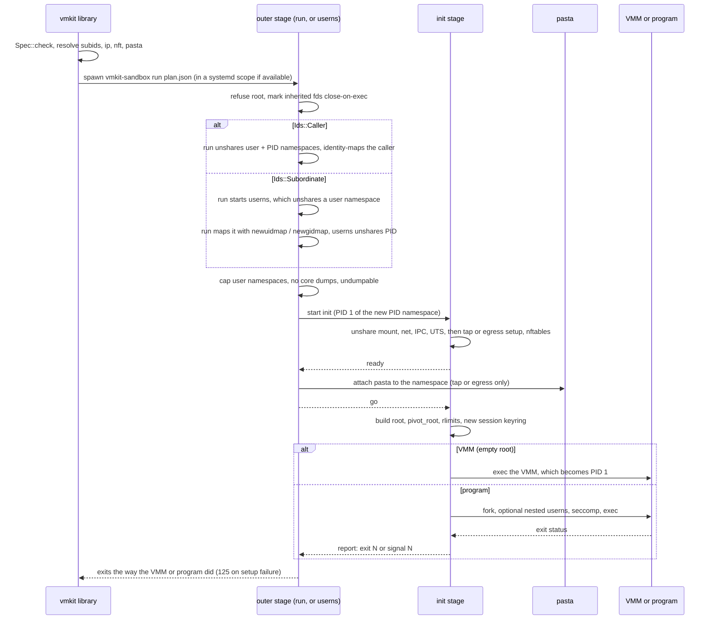

# The vmkit-sandbox helper

`vmkit-sandbox` (`src/bin/vmkit-sandbox.rs`) does the namespace work for every sandbox: VMMs started by `Vmm::create` and programs started by `vmkit::sandbox::spawn`. It is not meant to be run by hand. Linux only; on other systems it prints `vmkit-sandbox: only Linux is supported` and exits 2.

```
vmkit-sandbox run <plan.json>      outer stage: user + PID namespaces, attaches pasta, waits for the program
vmkit-sandbox userns <plan.json>   for subordinate ids: the user namespace that run maps from outside
vmkit-sandbox init <plan.json>     PID 1: mount, net, IPC and UTS namespaces, then the program
```

## The plan

The library checks a `sandbox::Spec`, resolves what the helper needs on the host, and writes a `Plan` as JSON to `<run_dir>/sandbox.json`:

- `spec`: the `Spec` itself (`init` checks it again before trusting the file);
- `root`: `<run_dir>/sandbox-root`, where the root is mounted while it is built;
- `pid_file`: `<run_dir>/vmm.pid`, where `run` writes the host PID of the sandbox's first process;
- `subid`: for `Ids::Subordinate`, the paths of `newuidmap` and `newgidmap` and the caller's range starts;
- `net`: the path of `ip`, and for a tap or egress network the `nft` path, the ruleset text, and the `pasta` path and arguments.

The host addresses in the ruleset are read from `/proc/net/fib_trie` when the plan is made.

When `cgroups_available()` is true and the spec has cgroup limits, the library starts the helper as `systemd-run --user --scope --quiet --collect -p MemoryMax=... -p CPUQuota=... -p TasksMax=... -- vmkit-sandbox run <plan.json>`. The helper runs in a process group of its own, so terminal signals reach only the caller.

## Stages

How the stages hand over: each later stage gets a socket on its stdin, and a stage whose parent dies sees end-of-file (and gets SIGKILL through its parent-death signal).



### run

1. Marks every inherited descriptor above stderr close-on-exec and reads the plan.
2. Refuses to run if its real or effective uid is 0.
3. For `Ids::Subordinate`, starts `userns`, waits for `unshared`, runs `newuidmap <pid> 0 <uid> 1 1 <subuid start> <count>` (and the same for gids), sends `mapped`, and then only waits and mirrors `userns`'s exit.
4. Otherwise unshares user and PID namespaces, writes `deny` to `setgroups`, and identity-maps the caller's uid and gid (one id each). A permission error here names `scripts/install-apparmor.sh`.

### userns (subordinate ids only)

Unshares a user namespace, sends `unshared`, waits for `mapped`, then unshares a PID namespace and continues like `run`.

### In the new user namespace (run or userns)

- Writes `/proc/sys/user/max_user_namespaces`: `0`, or `1` when the spec asks for a nested namespace, so nothing in the sandbox can create user namespaces of its own (the AppArmor profile's permission would otherwise reach the program too).
- Sets the core dump limit to 0 and makes itself undumpable.
- Raises `CAP_SYS_ADMIN` and `CAP_NET_ADMIN` as ambient capabilities for `init` and `pasta`.
- Starts `init`, writes its PID to the pid file, waits for `ready`, attaches `pasta` with `--netns /proc/<pid>/ns/net --netns-only` (for a tap or egress network), and sends `go`. If `pasta` fails, the sandbox is killed and the helper fails with `pasta`'s status.
- Waits for `init` and exits the same way: with the code or signal `init` reported, or `init`'s own status.

### init

1. Unshares mount, network, IPC and UTS namespaces.
2. Network: for a tap, brings up `lo`, creates `tap0` owned by the caller, gives it `172.30.0.1/30`, enables forwarding and `route_localnet` for this namespace, and loads the ruleset with `nft -f -`. For egress, brings up `lo` and loads the egress ruleset. For `Network::None`, brings up `lo`, except in the VMM sandbox, where loopback stays down.
3. Sends `ready`, waits for `go`.
4. Points stdin at `/dev/null`, makes all mounts private, and builds the root on `plan.root`:
   - `Root::Empty`: a 1 MiB tmpfs with the bound program;
   - `Root::Host`: a recursive clone of `/` set read-only and nosuid with `mount_setattr`, plus a fresh `/proc`;
   - `Root::Overlay`: an overlay with `userxattr` (one `lowerdir+` per layer on Linux 6.8 and later, else a single `lowerdir=` string limited to about a page), plus `/proc`, read-only `/sys`, and a small `/dev`.
5. Attaches each `Mount::Bind` by descriptor (`open_tree` without following a final symlink; a symlink is refused) and each `Mount::Tmpfs`. Read-only binds are remounted read-only and nosuid, keeping the flags the user namespace cannot clear.
6. `pivot_root(".", ".")`, detaches the old root, and remounts an empty root read-only.
7. Sets the open-file and process limits, a core limit of 0, and joins a new anonymous session keyring.
8. For the VMM sandbox (empty root, no nesting), execs the program directly, so the VMM is PID 1. Otherwise it forks the program and supervises it: it reaps every process, reports `exit N` or `signal N` to the outer stage when the program ends, and exits, which ends everything else in the PID namespace.

Before exec, the program's process sets its user (if given), its working directory and `no_new_privs`, clears ambient and inheritable capabilities, installs the seccomp filters when `seccomp` is set, and replaces the environment when `Command::env` is given.

### Nested user namespace

With `nest`, the forked program unshares a user namespace and `init` writes its maps from outside, mapping every id of the sandbox unchanged (`0 0 1` and `1 1 <count>`). The program then sets `max_user_namespaces` to 0 inside its own namespace. It is root over its files but has no capability over the sandbox's mount and network namespaces, and `init` is undumpable, so the program cannot trace it.
